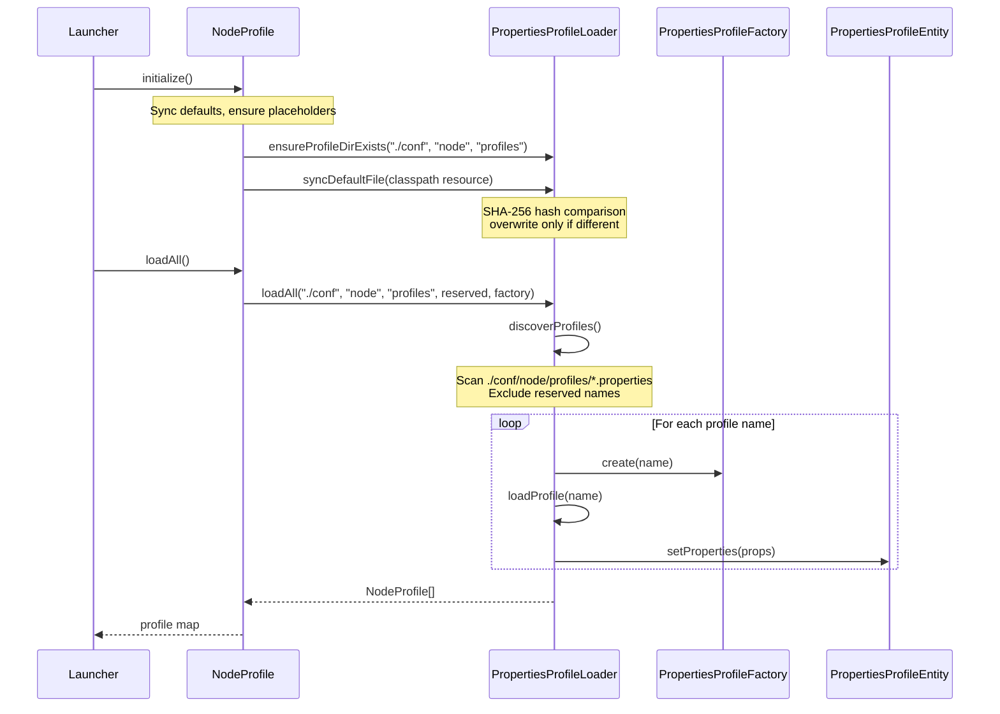
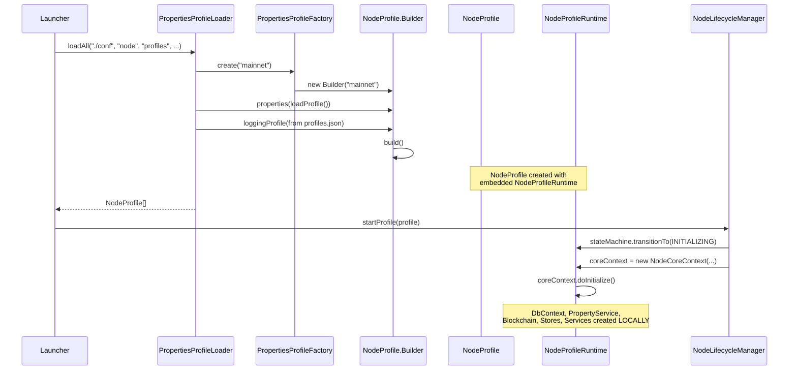

# Node Profile Loading - Complete Architecture

## Overview

This document describes the complete node profile loading mechanism, including `.properties`-based configuration resolution, NodeProfile + NodeProfileRuntime composition, logging profiles, and how multiple isolated node instances are bootrapped from disk.

### Architecture Summary

```
NodeProfile (Config Entity) ──composition──► NodeProfileRuntime (State Container)
    │                                           │
    │  Properties (Single Source of Truth)       │  LifecycleStateMachine
    │  NodeLoggingProfile reference              │  ProfileMetricCollector  
    │  GuiProfileSettings (lazy, optional)       │  NodeCoreContext (isolated resources)
    └─built via NodeProfile.Builder──────────────┘
```

> **Key Principle:** Each NodeProfile is a fully independent entity with its own DbContext, PropertyService, BlockchainProcessor, ThreadPool, etc. Profiles do NOT share mutable state.

---

## Table of Contents

- [Properties Profile Loader](#properties-profile-loader)
- [Scope Distinction](#scope-distinction)
- [Configuration Resolution Flow](#configuration-resolution-flow)
- [Node Profile Discovery](#node-profile-discovery)
- [Logging Profile Loading](#logging-profile-loading)
- [Default File Synchronization](#default-file-synchronization)
- [Profile-to-Instance Mapping](#profileto-instance-mapping)
- [Troubleshooting](#troubleshooting)

---

## Properties Profile Loader

### Core Components

| Class | Package | Purpose |
|-------|---------|---------|
| `PropertiesProfileLoader` | `application.utils.config` | Centralized utility for `.properties`-based profile loading |
| `PropertiesProfileEntity` | `application.utils.config` | Interface for loadable properties-profile entities |
| `PropertiesProfileFactory<T>` | `application.utils.config` | Factory for polymorphic properties-profile creation |
| `NodeProfile` | `application.module.node.profile` | Concrete node profile implementation |

### Path Schema (Unified)

All module configurations follow a standardized path schema:

```
./conf/{module}/{category}/*.properties
```

| Component | Description | Example |
|-----------|-------------|---------|
| `{module}` | Module identifier | `node`, `database` |
| `{category}` | Profile category subdirectory | `profiles`, `logging` |

### Concrete Directory Structure

```
./conf/
└── node/
    ├── profiles/                              ← Node profile configurations
    │   ├── node-default.properties            ← Default template (L1, synced from resources)
    │   ├── mainnet.properties                 ← User profile: "mainnet"
    │   └── testnet.properties                 ← User profile: "testnet"
    │
    └── logging/                               ← Logging preset configurations
        ├── logging-default.properties         ← Default template (synced from resources via SHA-256)
        ├── minimal.properties
        ├── standard.properties
        └── verbose.properties
```

---

## Scope Distinction

### Properties-Based Profiles vs Other Formats

The `PropertiesProfileLoader` is **specifically designed** for Java `.properties` files (key=value format). It does NOT handle:

| Format | Used By | Loader |
|--------|---------|--------|
| `.properties` | `NodeProfile`, logging presets | `PropertiesProfileLoader` |
| JSON | `MariaDbProfile` (database) | Own JSON-based loader |
| XML | Future profiles | Dedicated XML loader |

This distinction ensures that each profile format has an appropriate, type-safe loading mechanism without forcing all profiles into a single format.

---

## Configuration Resolution Flow



---

## Node Profile Discovery

### How `NodeProfile.loadAll()` Works

| Step | Action | Source |
|------|--------|--------|
| 1 | Delegate to `PropertiesProfileLoader.loadAll()` | `NodeProfile.loadAll()` |
| 2 | Resolve directory: `./conf/node/profiles/` | `PPL.resolveProfileDir()` |
| 3 | List all `*.properties` files | `Files.list()` |
| 4 | Extract profile name from filename | `filename.substring(0, length - 11)` |
| 5 | Skip reserved names | `RESERVED_PROFILE_NAMES` set |
| 6 | Create `NodeProfile` instance | `PropertiesProfileFactory.create(name)` |
| 7 | Load properties from file | `PPL.loadProfile()` |
| 8 | Set properties on entity | `PropertiesProfileEntity.setProperties()` |

### Reserved Profile Names

The following profile names are **excluded** from discovery:

| Name | Purpose |
|------|---------|
| `node-default` | Default property values (L1 template, not a runnable profile) |
| `logging-default` | Default logging configuration template |

---

## Logging Profile Loading

### How `LoggingProfileManager` Works

| Step | Action | Source |
|------|--------|--------|
| 1 | Module registers provider via `LoggingModuleRegistry.registerProvider()` | `NodeLoggingProvider`, `DatabaseLoggingProvider` |
| 2 | Provider creates presets (minimal, standard, verbose, debug) | `ModuleLoggingProfile` instances |
| 3 | On profile init, `ProfileLoggingApplier.apply()` called | Via node startup |
| 4 | Preset resolved from node properties or default | `profile.getString("logging.preset")` |
| 5 | JUL LogManager reconfigured with preset values | `ProfileLoggingApplier.applyToJUL()` |

### Logging Configuration Files

```
resources/conf/
├── node/logging/logging-default.properties    ← Default logging levels for node module
├── database/logging/logging-default.properties ← Default logging levels for database module
└── system/logging/logging-default.properties   ← System-level defaults
```

---

## Default File Synchronization

### SHA-256 Hash-Based Sync

Default files (`profile-default.properties`, `logging-default.properties`) are automatically synchronized from classpath resources to the runtime `./conf/` directory:

| Condition | Action |
|-----------|--------|
| Target file **missing** | Copy from resources |
| Target file exists, hash **differs** | Overwrite (update detected) |
| Target file exists, hash **matches** | Do nothing |

### How It Works

```java
// Pseudocode:
String resourceHash = SHA256(classpathResource);
if (!file.exists(target)) {
    copy(resource, target);
} else if (SHA256(target) != resourceHash) {
    copy(resource, target);  // Update!
}
```

### Placeholder File Creation

Empty placeholder files (`node.properties`, `logging.properties`) are created **only** when no user profiles are discovered:

```java
int profileCount = PropertiesProfileLoader.countProfiles("../conf", "node", "profiles", reservedNames);
if (profileCount == 0) {
    // Create empty placeholders
}
```

---

## NodeProfile + NodeProfileRuntime Composition

### Construction Flow



### profiles.json — Association Data Only

The `profiles.json` file stores only cross-cutting association data:

| Field | Type | Purpose |
|-------|------|---------|
| `loggingAssociations` | Object | `{"mainnet": "standard", "testnet": "debug"}` maps profile name → logging preset |
| `tabOrder` | String[] \| null | Custom tab ordering for GUI (null = automatic) |
| `maxConcurrentNodes` | Integer | Maximum nodes that can run simultaneously |

**NodeProfile is the Single Source of Truth** for all node configuration. The `.properties` file provides everything: identity, database, P2P, API, mining settings.

## Profile-to-Instance Mapping

```mermaid
graph TD
    A[./conf/node/profiles/*.properties] -->|PropertiesProfileLoader.loadAll()| B[NodeProfile.Builder[]]
    B -->|build()| C[NodeProfile[]<br/>+ NodeProfileRuntime embedded]
    C -->|For each profile| D[NodeLifecycleManager.startProfile()]
    D -->|coreContext.doInitialize()| E[DbContext created LOCALLY]
    D -->|constructor injection| F[Stores + Services created LOCALLY]

    G[SystemLogRouterHandler] -->|JUL events| H[SystemLogger]
    H -->|dispatch to all subscribers| I[SystemConsoleSubscriber]

    subgraph "Per-Profile Isolation"
        E
        F
    end

    subgraph "Global Aggregation"
        G
        H
        I
    end
```

---

## API Quick Reference

### PropertiesProfileLoader Methods

| Method | Description |
|--------|-------------|
| `resolveProfileDir(root, module, category)` | Resolves profile directory path |
| `discoverProfiles(root, module, category, reserved)` | Lists available `.properties` profile names |
| `countProfiles(root, module, category, reserved)` | Counts available profiles |
| `loadProfile(root, module, category, name)` | Loads single profile into Properties |
| `loadAll<T>(root, module, category, reserved, factory, type)` | Batch loads all `.properties` profiles |
| `syncDefaultFile(root, module, category, filename, resource)` | Syncs default file using SHA-256 |
| `ensureEmptyPlaceholderIfNoProfiles(...)` | Creates placeholders when needed |

### NodeProfile Methods

| Method | Description |
|--------|-------------|
| `loadAll()` | Load all node profiles from disk |
| `loadByName(String)` | Load specific profile by name |
| `discoverProfileNames()` | List available (non-reserved) profile names |
| `isReservedProfileName(String)` | Check if name is reserved |
| `initialize()` | Full init: sync defaults + placeholders |

---

## Troubleshooting

### Profile Not Loading?

1. **Check file exists**: Verify the `.properties` file is in `../conf/node/profiles/`
2. **Check reserved names**: Ensure the filename doesn't match reserved patterns (`profile-default`, `logging-default`)
3. **Check console output**: Look for `NodeProfile.loadAll()` debug logs
4. **Validate properties format**: The file must be a valid Java `.properties` format

### Logging Not Working?

1. **Check SystemLogRouterHandler installed**: Look for `[Bootstrap]` logs at startup
2. **Verify subscriber registered**: Check `SystemLogger.getInstance().getSubscriberCount()`
3. **Check logging preset**: Verify the profile has a valid `logging.preset` value
4. **Verify default files synced**: Check that `../conf/node/logging/logging-default.properties` exists

### Default File Not Updating?

1. **Check classpath resource**: Verify `/conf/node/profiles/node-default.properties` exists in JAR
2. **Check hash comparison**: Default files are only overwritten when SHA-256 hash differs
3. **Manual override**: Delete the runtime file to force re-sync on next startup

---

## Profile Creation Paths (GUI Wizard + CLI)

Node profiles can be created through two first-class paths, both converging on the same
persistence SSOT (`NodeProfileRepository` → `./conf/node/profiles/{name}.properties`):

### GUI Setup Wizard (multi-node onboarding)

Launched from the `NodePanel` onboarding empty-state ("+"/"Create Node Profile"). The
wizard is a headless-testable state machine (`NodeSetupWizardController`) driving the
canonical step chain:

```
database-selection → database-installation → database-connection → node-configuration → summary
```

| Step | Behaviour |
|------|-----------|
| `database-selection` | Engine choice (SQLite / MariaDB / PostgreSQL). SQLite → both DB steps auto-skipped. |
| `database-installation` | **Only when needed** ("ha szükséges"): embeds the existing Database-module engine panel (SSOT — version selection, **Download** with progress, extract, **Initialize**, my.ini/postgres config). An already-installed engine (`DatabaseConfigurationUtils.isDatabaseInstalled`, i.e. `database/<engine>/` non-empty) pre-selects "Skip". Blocks Next while not installed and not skipped. |
| `database-connection` | host / port / user / password / db name (+ TCP test) — persisted into the profile via the `ProfileCreateDefaults` SSOT at finish. |
| `node-configuration` | Suggested name (SSOT `ProfileNameSuggester`, `_NN` auto-suffix on taken names), testnet, ports (per-profile band by default or custom). |
| `summary` | Read-only review + conflict pre-check (SSOT `ProfileConflictDetector`, same as runtime arbitration) + "start immediately". |

The wizard has no logging step: every profile-creation path (wizard, `+` tab "New Empty
Default Profile", CLI `profile create`) seeds the new profile's logging assignment from
the node module's currently **applied** logging profile (a snapshot taken at creation
time, SSOT `ProfileRuntimeService.seedDefaultLoggingAssignment` → `LoggingAssignmentStore`
→ `conf/node/profiles.json`); while "Default" is the applied profile no assignment is
written (the built-in `logging-default` applies until the user assigns one). Existing
profiles are never touched by this seeding.

Finish goes through `WizardFinish.createProfile(...)` → `NodeProfileRepository.createProfile`
→ logging seed (applied profile) → optional `NodeModule.startNode(name)` → `NodePanel.addProfileTab`.

### CLI (headless)

```
signum-node profile create <name> [--network X] [--api-port N] [--p2p-port N] [--ws-port N]
signum-node profile list | info <name> | rename <old> <new> | delete <name> [--force]
signum-node profile run <name>
```

`profile create` uses the same `ProfileCreateDefaults` mapping (per-profile SQLite file or
server DB + name-derived deterministic port band), so CLI and wizard produce equivalent,
independently runnable profiles.

### GUI Profile Management (tab context menu)

Right-click a profile tab → **Rename…** (SSOT validation: pattern / reserved / taken,
`ProfileNameSuggester`-based suggestion) or **Delete…** (confirmation; extra warning when
the node is RUNNING — it is stopped first). Both delegate to the public
`NodePanel.renameProfileTab` / `removeProfileTab` APIs (repository SSOT).

### Node Logging Tab (per-node assignment display)

The node profile's **Logging** tab (`NodeLoggingPanel`) shows the <b>per-node
assignment</b> as the applied state — never the module-level applied marker. An
<b>unassigned</b> node profile therefore keeps the virtual **"Default"** entry selected
AND marked as applied: the node really runs with the built-in `logging-default` profile,
and the module's applied profile (its seed source at creation time) is not painted as
this node's applied profile. Applying a profile on this tab records the per-node
assignment (SSOT `LoggingAssignmentStore` → `conf/node/profiles.json`) and restarts the
node; applying the virtual **Default** entry clears the assignment (the node falls back
to the built-in `logging-default`).

### Logging Module — Assignments Table (auto-refresh)

The Logging module's **Assignments** sub-tab (`AssignmentPanel`) lists the
node-profile → logging-profile associations and is kept up to date by a **push**:
it subscribes to the `LoggingAssignmentStore.fireProfileChanged()` notification,
fired by the store's assignment writers and by the node-profile lifecycle
(`NodeProfileRepository` create / rename / delete) — so a newly created node profile
appears in the table without a manual re-scan. The table is also re-scanned when the
sub-tab is activated (covers out-of-process changes, e.g. the CLI). The automatic
refresh is skipped while the table holds unsaved row edits (the manual **Refresh**
button remains the explicit unconditional re-scan). The panel never holds a
long-lived `LoggingAssignmentStore` instance (its `ProfileConfig` cache would go
stale after a write by another instance) — a fresh store is created per operation,
the same per-call convention the rest of the app uses.

**`profiles.json` reload-on-write (stale-cache clobber protection).** Several
`ProfileConfig` instances share `conf/node/profiles.json` at once — each caches
its parsed document after the first read (the GUI's app-lifetime tab-order
instance in `NodePanel` is the classic one). Before the fix, any save from a
stale instance serialized its old snapshot and silently discarded concurrent
writes: e.g. creating a node profile (seed writes the new profile's logging
assignment) and then the GUI's `addProfileTab` tab-order save would **wipe the
just-seeded assignment** (the node ran with the built-in default despite the
creation-time seed). Every `ProfileConfig` mutating method
(`setTabOrder`, `setLoggingProfile`, `setLoggingPresets`, `setAutoStart`,
`setEnabled`) now starts with `reload()` (discard cache + re-read from disk),
so a save can never clobber another instance's writes.

---

## Related Documentation

- [`implementation_plan/unified_profile_loader.md`](../../implementation_plan/unified_profile_loader.md) - Unified Profile Loader implementation plan
- [`implementation_plan/multi_module_config_plan.md`](../../implementation_plan/multi_module_config_plan.md) - Multi-module config architecture
- [README.md](./README.md) - Node module overview