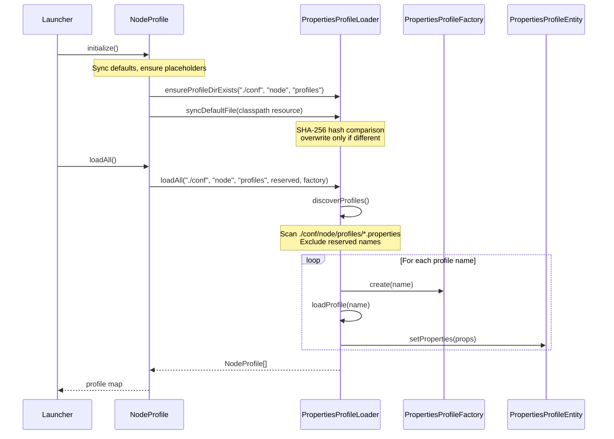
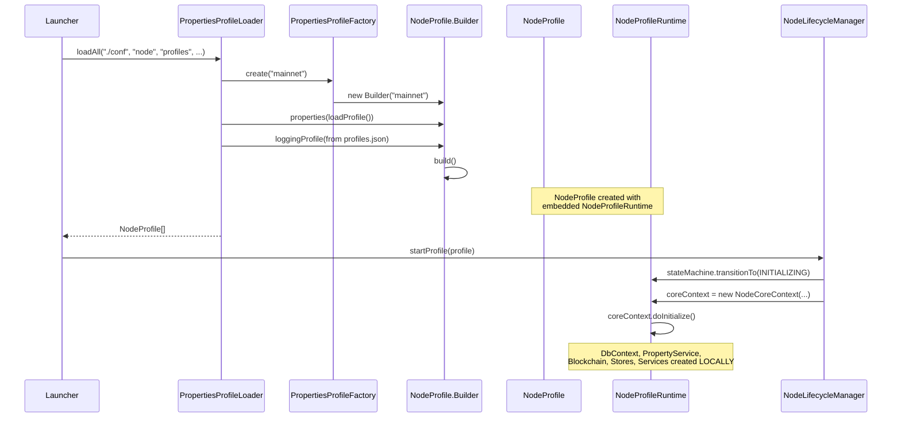

# Node Profile Loading - Complete Architecture

## Overview

This document describes the complete node profile loading mechanism, including `.properties`-based configuration resolution, NodeProfile + NodeProfileRuntime composition, logging profiles (isolated per-node Log4j2 `LoggerContext`s), and how multiple isolated node instances are bootstrapped from disk.

### Architecture Summary

```
NodeProfile (Config Entity) ──composition──► NodeProfileRuntime (State Container)
    │                                           │
    │  Properties (Single Source of Truth)       │  LifecycleStateMachine
    │  NodeLoggingProfile reference              │  ProfileMetricCollector  
    │  GuiProfileSettings (lazy, optional)       │  NodeCoreContext (isolated resources)
    └─built via NodeProfile.Builder──────────────┘
```

> **Key Principle:** Each NodeProfile is a fully independent entity with its own DbContext, PropertyService, BlockchainProcessor, ThreadPool, etc. Profiles do NOT share mutable state.

---

## Table of Contents

- [Properties Profile Loader](#properties-profile-loader)
- [Scope Distinction](#scope-distinction)
- [Configuration Resolution Flow](#configuration-resolution-flow)
- [Configuration Layer Model (L0/L1/L2)](#configuration-layer-model-l0-l1-l2)
- [Node Profile Discovery](#node-profile-discovery)
- [Logging Profile Loading](#logging-profile-loading)
- [Default File Synchronization](#default-file-synchronization)
- [Profile-to-Instance Mapping](#profileto-instance-mapping)
- [Troubleshooting](#troubleshooting)

---

## Properties Profile Loader

### Core Components

| Class | Package | Purpose |
|-------|---------|---------|
| `PropertiesProfileLoader` | `application.utils.config` | Centralized utility for `.properties`-based profile loading |
| `PropertiesProfileEntity` | `application.utils.config` | Interface for loadable properties-profile entities |
| `PropertiesProfileFactory<T>` | `application.utils.config` | Factory for polymorphic properties-profile creation |
| `NodeProfile` | `application.module.node.profile` | Concrete node profile implementation |

### Path Schema (Unified)

All module configurations follow a standardized path schema:

```
./conf/{module}/{category}/*.properties
```

| Component | Description | Example |
|-----------|-------------|---------|
| `{module}` | Module identifier | `node`, `database` |
| `{category}` | Profile category subdirectory | `profiles`, `logging` |

### Concrete Directory Structure

```
./conf/
└── node/
    ├── profiles/                              ← Node profile configurations
    │   ├── default.properties                 ← Runtime L1: user-editable per-key
    │   │                                        overrides (reserved name, auto-created
    │   │                                        at first start, never synced, not
    │   │                                        GUI-editable)
    │   ├── node-default.properties            ← Reference template (L0 documentation,
    │   │                                        read-only, SHA-256 synced from resources)
    │   ├── mainnet.properties                 ← User profile: "mainnet" (L2)
    │   └── testnet.properties                 ← User profile: "testnet" (L2)
    │
    └── logging/                               ← Logging preset configurations
        ├── default.properties                 ← Runtime L1: user-editable overrides for
        │                                        every logging profile (reserved name,
        │                                        auto-created, never synced)
        ├── logging-default.properties         ← Reference template (L0 documentation,
        │                                        read-only, SHA-256 synced from resources)
        ├── minimal.properties
        ├── standard.properties
        └── verbose.properties
```

---

## Scope Distinction

### Properties-Based Profiles vs Other Formats

The `PropertiesProfileLoader` is **specifically designed** for Java `.properties` files (key=value format). It does NOT handle:

| Format | Used By | Loader |
|--------|---------|--------|
| `.properties` | `NodeProfile`, logging presets | `PropertiesProfileLoader` |
| JSON | `MariaDbProfile` (database) | Own JSON-based loader |
| XML | Future profiles | Dedicated XML loader |

This distinction ensures that each profile format has an appropriate, type-safe loading mechanism without forcing all profiles into a single format.

---

## Configuration Resolution Flow



---

## Node Profile Discovery

### How `NodeProfile.loadAll()` Works

| Step | Action | Source |
|------|--------|--------|
| 1 | Delegate to `PropertiesProfileLoader.loadAll()` | `NodeProfile.loadAll()` |
| 2 | Resolve directory: `./conf/node/profiles/` | `PPL.resolveProfileDir()` |
| 3 | List all `*.properties` files | `Files.list()` |
| 4 | Extract profile name from filename | `filename.substring(0, length - 11)` |
| 5 | Skip reserved names | `RESERVED_PROFILE_NAMES` set |
| 6 | Create `NodeProfile` instance | `PropertiesProfileFactory.create(name)` |
| 7 | Load properties from file | `PPL.loadProfile()` |
| 8 | Set properties on entity | `PropertiesProfileEntity.setProperties()` |

### Reserved Profile Names

The following profile names are **excluded** from discovery (SSOT:
`NodeProfile.RESERVED_PROFILE_NAMES`, `ModuleLoggingProvider`,
`LoggingProfileRepository`):

| Name | Purpose |
|------|---------|
| `default` | **Runtime L1 layer** — the user-editable per-key override file (`default.properties`); auto-created at first start, reserved (not a runnable profile, not GUI-editable) |
| `node-default` | Reference template documenting the node module's L0 defaults (read-only, SHA-256 synced from classpath resources) |
| `logging-default` | Reference template documenting the L0 logging defaults (read-only, SHA-256 synced from classpath resources) |

### Configuration Layer Model (L0 / L1 / L2)

Per key, the highest layer wins:

| Layer | Node profiles | Logging |
|-------|--------------|---------|
| **L0** (hardcoded) | `node.props.Props` | `NodeLoggingProfile.getDefaults()` / `LoggerProfile.applyInternalDefaults()` |
| **L1** (cross-profile overrides) | `conf/node/profiles/default.properties` | `conf/node/logging/default.properties` |
| **L2** (per-profile) | `conf/node/profiles/{name}.properties` | `conf/node/logging/{profile}.properties` (+ the shared `logging.properties`) |

- **L1 is user-editable and file-only**: the GUI never lists `default` (the
  virtual **Default** entry of the logging UI is the built-in L0 baseline, not
  this file). The file is auto-created at first start when missing (header +
  fully commented L0 documentation), is **never overwritten** by the classpath
  sync, and may be deleted at any time — the configuration then degrades to L0
  and the file is re-created on the next start.
- **The templates are reference-only**: `node-default.properties` and
  `logging-default.properties` ship fully commented, stay up to date via the
  SHA-256 sync, and are **not read at runtime**.
- Loading SSOTs: node — `EffectiveNodeProps` (runtime: `Signum.loadPropertiesForProfile`;
  GUI baselines: `EffectiveNodeProps.baselineValue`); logging —
  `ConfigurationUtils.loadEffectiveLoggerProfile` (shared `logging` profile),
  `NodeLoggingApplier.applyForNodeProfile` (node → isolated `LoggerContext` via `NodeLoggingContextApplier`; other modules → `ProfileLogger` bus level) + `NodeLoggingConfigResolver` (pure L0/L1/L2 resolution),
  `LoggingProfileManager` + `EffectiveProfileResolver` (preview composition) —
  all resolve L1 to `default.properties`.

> **Implementation status:** the `default.properties` L1 layer landed as
> **F7** (2026-10-20) —
> [`implementation_plan/unified_defaults_layers_plan.md`](../../implementation_plan/unified_defaults_layers_plan.md)
> (§3, decisions D1–D5).

---

## Logging Profile Loading

### How logging is applied

Logging is driven by a **per-node isolated Log4j2 `LoggerContext`** (one per node
profile). The stored profiles are plain `.properties` files (L0/L1/L2); at start and
on every GUI **Apply** they are resolved into a generated Log4j2 config that
reconfigures the node's own context in place — **no node restart**. The node context
is the **single level gate** for node events (the GUI bus only displays/forwards).

| Step | Action | Source |
|------|--------|--------|
| 1 | Each module registers a logging provider carrying its L0 defaults | `NodeLoggingProvider`, `DatabaseLoggingProvider` → `LoggingModuleRegistry.register()` |
| 2 | The node profile's per-node logging assignment is read (fallback: reserved `logging-default`) | `LoggingAssignmentStore` (`conf/node/profiles.json`) |
| 3 | The effective profile's L0/L1/L2 layers are merged and resolved to Log4j2 levels | `NodeLoggingConfigResolver` (pure function) |
| 4 | The resolved config is written to a generated `*.log4j2.properties` (not SSOT) | `NodeLoggingConfigWriter` (atomic) |
| 5 | The node `LoggerContext` is created / **reconfigured in place** (live Apply) | `NodeLoggingContextApplier` → `NodeLoggingContextManager` / `NodeLoggingContext` |
| 6 | Node-context events are bridged to the GUI bus | `ProfileConsoleAppender` → `ProfileLogger` (Node Console); `SystemConsoleAppender` → `SystemLogger` (System Console) |

> **Node vs. other modules:** `NodeLoggingApplier.applyForNodeProfile` routes the
> **node** module through the isolated context (step 5); other modules (e.g.
> `database`) use the legacy `ProfileLogger` bus level (`<module>.level` →
> `ProfileLogger.setLogLevel`).

### Logging Configuration Files

```
resources/conf/
├── node/logging/default.properties            ← L1 auto-create seed (header + comments, 0 active lines)
├── node/logging/logging-default.properties    ← Reference template (L0 documentation) for node module
├── database/logging/logging-default.properties ← Reference template for database module
└── system/logging/logging-default.properties   ← System-level defaults
```

---

## Default File Synchronization

### SHA-256 Hash-Based Sync

The **reference templates** (`node-default.properties`, `logging-default.properties`)
are automatically synchronized from classpath resources to the runtime `./conf/`
directory — they are read-only L0 documentation, so overwriting them is safe:

> The **runtime L1 files** (`default.properties` in `profiles/` and `logging/`)
> are **exempt from the sync**: they are user-owned, created once at first start
> when missing (auto-create), and never overwritten afterwards — a user edit to
> an L1 file always survives an application update.

| Condition | Action |
|-----------|--------|
| Target file **missing** | Copy from resources |
| Target file exists, hash **differs** | Overwrite (update detected) |
| Target file exists, hash **matches** | Do nothing |

### How It Works

```java
// Pseudocode:
String resourceHash = SHA256(classpathResource);
if (!file.exists(target)) {
    copy(resource, target);
} else if (SHA256(target) != resourceHash) {
    copy(resource, target);  // Update!
}
```

### Placeholder File Creation

Empty placeholder files (`node.properties`, `logging.properties`) are created **only** when no user profiles are discovered:

```java
int profileCount = PropertiesProfileLoader.countProfiles("../conf", "node", "profiles", reservedNames);
if (profileCount == 0) {
    // Create empty placeholders
}
```

---

## NodeProfile + NodeProfileRuntime Composition

### Construction Flow



### profiles.json — Association Data Only

The `profiles.json` file stores only cross-cutting association data:

| Field | Type | Purpose |
|-------|------|---------|
| `loggingAssociations` | Object | `{"mainnet": "standard", "testnet": "debug"}` maps profile name → logging profile |
| `tabOrder` | String[] \| null | Custom tab ordering for GUI (null = automatic) |
| `maxConcurrentNodes` | Integer | Maximum nodes that can run simultaneously |

**NodeProfile is the Single Source of Truth** for all node configuration. The `.properties` file provides everything: identity, database, P2P, API, mining settings.

## Profile-to-Instance Mapping

```mermaid
graph TD
    A[./conf/node/profiles/*.properties] -->|PropertiesProfileLoader.loadAll()| B[NodeProfile.Builder[]]
    B -->|build()| C[NodeProfile[]<br/>+ NodeProfileRuntime embedded]
    C -->|For each profile| D[NodeLifecycleManager.startProfile()]
    D -->|coreContext.doInitialize()| E[DbContext created LOCALLY]
    D -->|constructor injection| F[Stores + Services created LOCALLY]

    D -->|NodeLoggingContextApplier| G[Node LoggerContext<br/>reconfigured in place]
    G -->|ProfileConsoleAppender| H[ProfileLogger bus]
    H -->|subscribers| I[GUI Node Console]

    J[Global LoggerContext] -->|SystemConsoleAppender| K[SystemLogger]
    K -->|subscribers| L[GUI System Console]

    subgraph "Per-Profile Isolation"
        E
        F
        G
        H
        I
    end

    subgraph "Global Aggregation"
        J
        K
        L
    end
```

---

## API Quick Reference

### PropertiesProfileLoader Methods

| Method | Description |
|--------|-------------|
| `resolveProfileDir(root, module, category)` | Resolves profile directory path |
| `discoverProfiles(root, module, category, reserved)` | Lists available `.properties` profile names |
| `countProfiles(root, module, category, reserved)` | Counts available profiles |
| `loadProfile(root, module, category, name)` | Loads single profile into Properties |
| `loadAll<T>(root, module, category, reserved, factory, type)` | Batch loads all `.properties` profiles |
| `syncDefaultFile(root, module, category, filename, resource)` | Syncs default file using SHA-256 |
| `ensureEmptyPlaceholderIfNoProfiles(...)` | Creates placeholders when needed |

### NodeProfile Methods

| Method | Description |
|--------|-------------|
| `loadAll()` | Load all node profiles from disk |
| `loadByName(String)` | Load specific profile by name |
| `discoverProfileNames()` | List available (non-reserved) profile names |
| `isReservedProfileName(String)` | Check if name is reserved |
| `initialize()` | Full init: sync defaults + placeholders |

---

## Troubleshooting

### Profile Not Loading?

1. **Check file exists**: Verify the `.properties` file is in `../conf/node/profiles/`
2. **Check reserved names**: Ensure the filename doesn't match reserved patterns (`profile-default`, `logging-default`)
3. **Check console output**: Look for `NodeProfile.loadAll()` debug logs
4. **Validate properties format**: The file must be a valid Java `.properties` format

### Logging Not Working?

1. **Check the node context applied**: look for `Signum.applyNodeLoggingConfiguration` / `NodeLoggingContextApplier` logs at start; the generated `*.log4j2.properties` file should exist
2. **Verify the GUI bus appenders are attached**: `ProfileConsoleAppender` (Node Console) / `SystemConsoleAppender` (System Console) are re-attached after every (re)configure
3. **Check the per-node assignment**: the node's logging profile (or the reserved `logging-default` fallback) in `conf/node/profiles.json`
4. **Verify the reference template synced**: `../conf/node/logging/logging-default.properties` exists

### Default File Not Updating?

1. **Check classpath resource**: Verify `/conf/node/profiles/node-default.properties` exists in JAR
2. **Check hash comparison**: Reference templates are only overwritten when SHA-256 hash differs
3. **Manual re-sync**: Delete the runtime template file to force re-sync on next startup
4. **`default.properties` (runtime L1) is exempt**: it is user-owned — never re-synced
   and never reset by an update; delete it to restore pure L0 defaults (it is
   re-created empty on the next start)

### L1 (`default.properties`) Changes Have No Effect?

1. **Apply needed (no restart)**: L1 is re-read on the next logging **Apply** — a GUI Apply
   re-runs the resolver and reconfigures the live node `LoggerContext` (and the global
   context) without restarting the node
2. **Key must have an L0 counterpart**: unknown keys cannot override anything
3. **L2 wins per key**: a key set in the profile's own file (L2) overrides L1

---

## Profile Creation Paths (GUI Wizard + CLI)

Node profiles can be created through two first-class paths, both converging on the same
persistence SSOT (`NodeProfileRepository` → `./conf/node/profiles/{name}.properties`):

### GUI Setup Wizard (multi-node onboarding)

Launched from the `NodePanel` onboarding empty-state ("+"/"Create Node Profile"). The
wizard is a headless-testable state machine (`NodeSetupWizardController`) driving the
canonical step chain:

```
database-selection → database-installation → database-connection → node-configuration → summary
```

| Step | Behaviour |
|------|-----------|
| `database-selection` | Engine choice (SQLite / MariaDB / PostgreSQL). SQLite → both DB steps auto-skipped. |
| `database-installation` | **Only when needed** ("ha szükséges"): embeds the existing Database-module engine panel (SSOT — version selection, **Download** with progress, extract, **Initialize**, my.ini/postgres config). An already-installed engine (`DatabaseConfigurationUtils.isDatabaseInstalled`, i.e. `database/<engine>/` non-empty) pre-selects "Skip". Blocks Next while not installed and not skipped. |
| `database-connection` | host / port / user / password / db name (+ TCP test) — persisted into the profile via the `ProfileCreateDefaults` SSOT at finish. |
| `node-configuration` | Suggested name (SSOT `ProfileNameSuggester`, `_NN` auto-suffix on taken names), testnet, ports (per-profile band by default or custom). |
| `summary` | Read-only review + conflict pre-check (SSOT `ProfileConflictDetector`, same as runtime arbitration) + "start immediately". |

The wizard has no logging step: every profile-creation path (wizard, `+` tab "New Empty
Default Profile", CLI `profile create`) seeds the new profile's logging assignment from
the node module's currently **applied** logging profile (a snapshot taken at creation
time, SSOT `ProfileRuntimeService.seedDefaultLoggingAssignment` → `LoggingAssignmentStore`
→ `conf/node/profiles.json`); while "Default" is the applied profile no assignment is
written (the built-in `logging-default` applies until the user assigns one). Existing
profiles are never touched by this seeding.

Finish goes through `WizardFinish.createProfile(...)` → `NodeProfileRepository.createProfile`
→ logging seed (applied profile) → optional `NodeModule.startNode(name)` → `NodePanel.addProfileTab`.

### CLI (headless)

```
signum-node profile create <name> [--network X] [--api-port N] [--p2p-port N] [--ws-port N]
signum-node profile list | info <name> | rename <old> <new> | delete <name> [--force]
signum-node profile run <name>
```

`profile create` uses the same `ProfileCreateDefaults` mapping (per-profile SQLite file or
server DB + name-derived deterministic port band), so CLI and wizard produce equivalent,
independently runnable profiles.

### GUI Profile Management (tab context menu)

Right-click a profile tab → **Rename…** (SSOT validation: pattern / reserved / taken,
`ProfileNameSuggester`-based suggestion) or **Delete…** (confirmation; extra warning when
the node is RUNNING — it is stopped first). Both delegate to the public
`NodePanel.renameProfileTab` / `removeProfileTab` APIs (repository SSOT).

### Node Logging Tab (per-node assignment display)

The node profile's **Logging** tab (`NodeLoggingPanel`) shows the <b>per-node
assignment</b> as the applied state — never the module-level applied marker. An
<b>unassigned</b> node profile therefore keeps the virtual **"Default"** entry selected
AND marked as applied: the node really runs with the built-in `logging-default` profile,
and the module's applied profile (its seed source at creation time) is not painted as
this node's applied profile. Applying a profile on this tab records the per-node
assignment (SSOT `LoggingAssignmentStore` → `conf/node/profiles.json`) and applies it **live**
(P2.4: a running node is reconfigured in place — **no restart**; a stopped node is not started
and picks up the change on its next start); applying the virtual **Default** entry clears the
assignment (the node falls back to the built-in `logging-default`).

### Logging Module — Assignments Table (auto-refresh)

The Logging module's **Assignments** sub-tab (`AssignmentPanel`) lists the
node-profile → logging-profile associations and is kept up to date by a **push**:
it subscribes to the `LoggingAssignmentStore.fireProfileChanged()` notification,
fired by the store's assignment writers and by the node-profile lifecycle
(`NodeProfileRepository` create / rename / delete) — so a newly created node profile
appears in the table without a manual re-scan. The table is also re-scanned when the
sub-tab is activated (covers out-of-process changes, e.g. the CLI). The automatic
refresh is skipped while the table holds unsaved row edits (the manual **Refresh**
button remains the explicit unconditional re-scan). The panel never holds a
long-lived `LoggingAssignmentStore` instance (its `ProfileConfig` cache would go
stale after a write by another instance) — a fresh store is created per operation,
the same per-call convention the rest of the app uses.

**`profiles.json` reload-on-write (stale-cache clobber protection).** Several
`ProfileConfig` instances share `conf/node/profiles.json` at once — each caches
its parsed document after the first read (the GUI's app-lifetime tab-order
instance in `NodePanel` is the classic one). Before the fix, any save from a
stale instance serialized its old snapshot and silently discarded concurrent
writes: e.g. creating a node profile (seed writes the new profile's logging
assignment) and then the GUI's `addProfileTab` tab-order save would **wipe the
just-seeded assignment** (the node ran with the built-in default despite the
creation-time seed). Every `ProfileConfig` mutating method
(`setTabOrder`, `setLoggingProfile`, `setLoggingPresets`, `setAutoStart`,
`setEnabled`) now starts with `reload()` (discard cache + re-read from disk),
so a save can never clobber another instance's writes.

---

## Related Documentation

- [`implementation_plan/unified_profile_loader.md`](../../implementation_plan/unified_profile_loader.md) - Unified Profile Loader implementation plan
- [`implementation_plan/multi_module_config_plan.md`](../../implementation_plan/multi_module_config_plan.md) - Multi-module config architecture
- [README.md](./README.md) - Node module overview